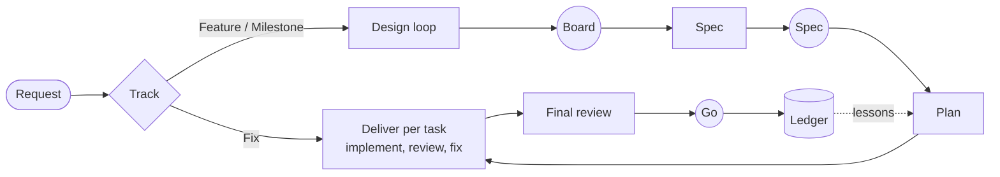

# GentleTeaM (GTM)

<picture>
  <source media="(prefers-color-scheme: dark)" srcset="docs/assets/banner-dark.png">
  
</picture>

[](https://github.com/MorganKryze/GentleTeaM/releases)
[](https://github.com/MorganKryze/GentleTeaM/actions/workflows/validate.yml)
[](LICENSE)
[](docs/install.md)

An agent-team method for [Claude Code](https://code.claude.com) that spares your attention,
packaged as a plugin. GTM runs a small team of role agents (designer, architect, implementer, reviewers) that design,
specify, build and review your change, while you make three decisions per feature: approve the
board, approve the spec synthesis, give the go. Everything else is settled inside the team, and
every ruling it took is listed for you at the end, with its cost if wrong. It spares your
attention, not agent time: see [what it costs](#-what-it-costs).

## 🧭 Why GTM
Agent teams can now write and review most of a feature. What they also produce is reading:
reports, specs, reviews, status updates. GTM spends that output inside the team and hands you
verdicts, decision cards and visuals, in your language. It sizes the process to the change and
keeps the team's working files out of your reading. More in the
[manifesto](docs/manifesto.md).

## ⚙️ How it works



Circles are your touchpoints. Full description: [method](docs/method.md).

| Track | When | What you do |
| --- | --- | --- |
| 🔧 Fix | at most 3 files, no schema, migration or auth change | approve a 3-line design, give the go |
| 🧩 Feature | one capability, one branch | approve the board (if screens change), the spec synthesis, the go |
| 🗺️ Milestone | several branches | approve the decomposition, then the Feature touchpoints per branch |

A Fix that grows past its file ceiling escalates to a Feature on its own; on security or data
ground it stays a Fix and that specialist reviews it. Nothing downgrades mid-task.

## 📦 Install
```
/plugin marketplace add MorganKryze/GentleTeaM
/plugin install gtm@gentleteam
```
On Claude Code 2.1.275 or later, `/plugin install gtm --marketplace MorganKryze/GentleTeaM` does
both. Project-wide install, updates and pinning: [install](docs/install.md).

## 🚀 Quick start
1. `/gtm:init`: GTM reads your repository and drafts a one-page brief, the config, your
   conventions and a **team profile** (what matters most here, and from that, how hard each role
   thinks and which specialists exist). You approve or edit each in one reply.
2. `/gtm:gtm <what you want done>` (listed as `/gtm:gtm (gtm)`; bare `/gtm` may also resolve when
   no other command shares the name): GTM picks the track with at most two questions and runs it.
3. Later: `/gtm:retro` after shipping, `/gtm:tune` when the team feels slow, costly or blind to
   something, `/gtm:brief-me` to understand any artifact without reading it.

## 💸 What it costs
GTM trades agent time for your attention. Measured on GTM's own branches
([ledger](.gtm/ledger.md)):

| Change | Track | Agent wall time |
| --- | --- | --- |
| 2 files, on security ground | Fix | 71 s |
| a docs fix and one workflow argument, 2 tasks | Feature | 11 min, 61% of it final review |
| a workflow change, 3 tasks | Feature | 58 min |

Every role runs Opus by default, so a Feature uses more of your plan than asking Claude Code
directly; a Fix is the cheap path. Installed and idle, GTM adds about 1,300 tokens to a session.
No controlled comparison with Claude Code alone has been run yet.

## 👥 Roles
All roles default to Opus and differ by reasoning effort; your team profile can change any of them.

| Role | Job | Effort |
| --- | --- | --- |
| analyst | clarifies the request, proposes the track | medium |
| designer | PNG mockup boards, light and dark | medium |
| design-critic | scores boards with measurements (read-only) | high |
| architect | spec, then task plan; replays risky tasks | high |
| implementer | one task, test-first | low, raised per fix round |
| reviewer | spec compliance, then code quality (read-only) | medium |
| security-reviewer 🔒 | on trigger: isolation, trust boundaries, auth (read-only) | xhigh |
| data-reviewer | on trigger: lost or altered data (read-only) | high |
| ux-qa | on trigger: screens, overflow, targets, axe | medium |
| final-reviewer | whole branch, once (read-only) | xhigh |
| release-qa | live journey after you deploy | low |

Specialists trigger on path patterns from your team profile, matched against the files the
implementer reports changing: a file it leaves out triggers nothing. The final review reads the
whole branch; a Fix has none. Details: [roles](docs/roles.md).

## 🧱 Principles
- **Your attention is the scarce resource:** For-you syntheses, decision cards with a
  recommendation, detail on demand, visuals over prose. [principles](docs/principles.md)
- **Light over complete,** with security and data integrity as non-negotiables.
- **Evidence before claims, tests first,** file-based hand-offs, specialists on trigger.
- **Weights are a project decision,** recorded with reasons and revisited with evidence.
- **Nothing pushed, merged or released without your go;** history kept, no squash by default.
- **Stealth mode** for repositories that are not yours: GTM's working files stay out of the
  project and its commits follow the project's conventions. It does not override a project's
  rules on AI tools and disclosure. [method](docs/method.md#stealth-mode)

All fifteen positions, with their costs: [positions](docs/positions.md).

## 📚 Docs
[Manifesto](docs/manifesto.md) · [Positions](docs/positions.md) · [Principles](docs/principles.md) ·
[Method](docs/method.md) · [Roles](docs/roles.md) · [Glossary](docs/glossary.md) ·
[Install](docs/install.md) · [Companion plugins](docs/companions.md) ·
[Contributing](docs/contributing.md) · [Examples](examples/README.md) · [Changelog](CHANGELOG.md)

## 🙏 Inspirations
GTM borrows openly from:
- [BMAD-METHOD](https://github.com/bmad-code-org/BMAD-METHOD): scale-adaptive entry doors.
- [GitHub spec-kit](https://github.com/github/spec-kit): the constitution, `[NEEDS CLARIFICATION]`,
  parallel-safe task tags.
- [superpowers](https://github.com/obra/superpowers): fresh context per task, spec-then-quality
  review, verification before completion.
- [compound-engineering](https://github.com/EveryInc/compound-engineering-plugin): the compound
  step, where each solved problem feeds the next plan.
- [Agent OS](https://github.com/buildermethods/agent-os): small standards injected on demand.
- [Kiro](https://kiro.dev/docs/specs/): EARS acceptance lines.

## License
[AGPL-3.0-only](LICENSE).
