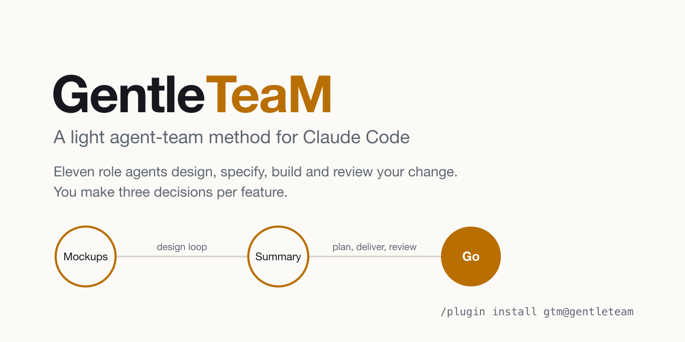

# GentleTeaM (GTM)

<picture>
  <source media="(prefers-color-scheme: dark)" srcset="docs/assets/banner-dark.png">
  
</picture>

[](https://github.com/MorganKryze/GentleTeaM/releases)
[](https://github.com/MorganKryze/GentleTeaM/actions/workflows/validate.yml)
[](LICENSE)
[](https://morgankryze.github.io/GentleTeaM/start/install/)

GTM is a plugin for [Claude Code](https://code.claude.com) that spares your attention. A small
team of role agents draws the mockups of your change, writes its spec, then builds and reviews
it. You make three decisions per feature: approve the mockups, approve the summary of the spec,
give the go. Every decision the team took without you is listed at the end, with its cost if
wrong. Read the documentation at <https://morgankryze.github.io/GentleTeaM/>.

## 📦 Install
```
/plugin marketplace add MorganKryze/GentleTeaM
/plugin install gtm@gentleteam
```
Then run `/gtm:init` in your project. Project-wide install, updates and pinning:
[install](https://morgankryze.github.io/GentleTeaM/start/install/).

## 💸 What it costs
GTM trades agent time for your attention. Measured on GTM's own changes:

| Change | Size | Agent time | Measured on |
| --- | --- | --- | --- |
| 2 files, on security ground | Fix | 71 s | GTM 0.3.0 |
| a docs fix and one workflow argument, 2 tasks | Feature | 11 min | GTM 0.3.0 |
| a workflow change, 3 tasks | Feature | 58 min | GTM 0.2.0 |

Installed and idle, GTM adds about 1,470 tokens to a session. A Feature uses more of your plan
than asking Claude Code directly; a Fix is the cheap path. What a change costs and how to lower
it: [the cost guide](https://morgankryze.github.io/GentleTeaM/guides/too-slow/).

## 📚 Documentation
The site, <https://morgankryze.github.io/GentleTeaM/>, has five paths:
[Start here](https://morgankryze.github.io/GentleTeaM/start/install/) ·
[Tutorial](https://morgankryze.github.io/GentleTeaM/tutorial/first-feature/) ·
[Guides](https://morgankryze.github.io/GentleTeaM/guides/which-size/) ·
[Reference](https://morgankryze.github.io/GentleTeaM/reference/roles/) ·
[Why](https://morgankryze.github.io/GentleTeaM/why/). Release notes: [changelog](CHANGELOG.md).

## License
[AGPL-3.0-only](LICENSE).
