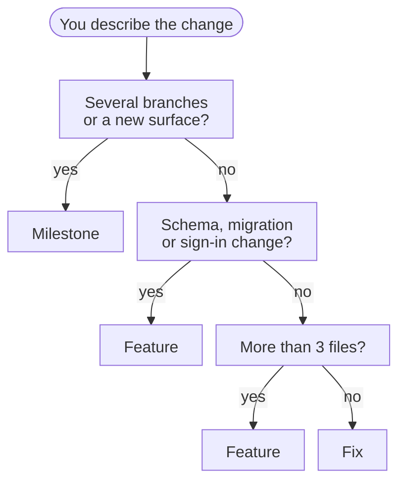
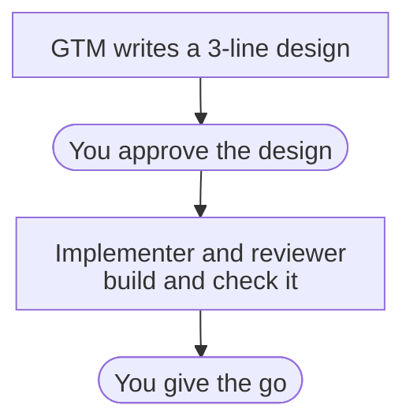
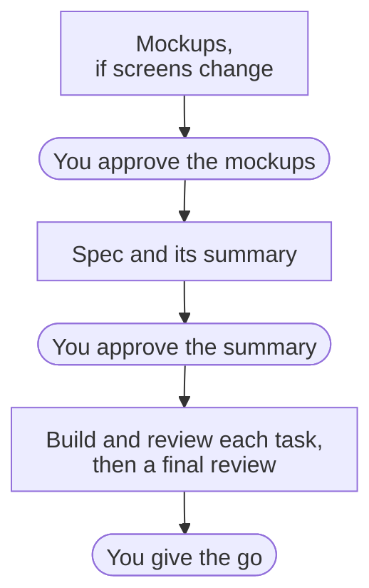
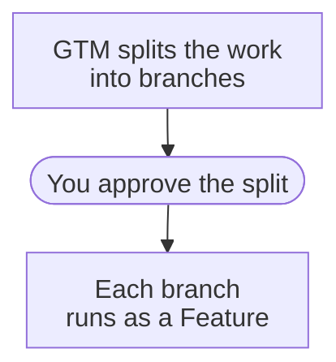
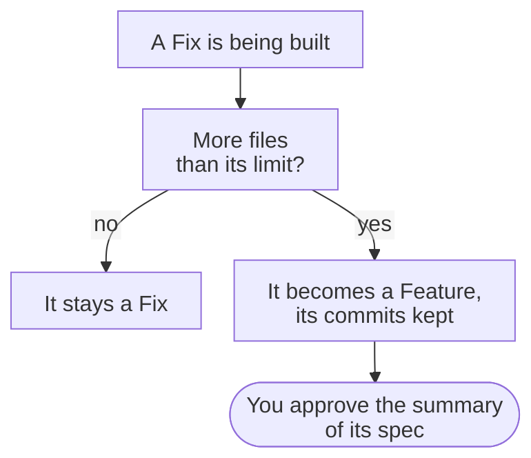

::: callout summary
- **You will learn:** how GTM sizes a change, and what each size asks of you.
- **Reading time:** 4 minutes.
- **Before this:** [Your first Feature](/tutorial/first-feature/) helps, but is not required.
:::

Three questions decide it. GTM sorts every change into one of three tracks: a
[Fix](/reference/glossary/#fix) (at most 3 files), a [Feature](/reference/glossary/#feature)
(one capability on one branch) or a [Milestone](/reference/glossary/#milestone) (several
branches). You describe the change; GTM asks at most two questions and proposes the track.

How to read it: start at the amber step, answer each question from the top, and stop at the
first track you reach.

## What does each track ask of me?

A few terms first:

- **[Checkpoint](/reference/glossary/#checkpoint):** a moment where you decide; the rest runs
  without you.
- **[Mockups](/reference/glossary/#mockups):** one page showing each new screen in light and dark.
- **[Spec](/reference/glossary/#spec):** the document that says what will be built and how each
  part is checked; you approve its ten-line [summary](/reference/glossary/#summary).
- **[Final review](/reference/glossary/#final-review):** one check of the whole branch against
  the spec, once every task is done, before you give the go.

### What does a Fix ask of me?

Two checkpoints. A Fix changes at most 3 files. It has no mockups, no spec and no final review.

How to read it: two amber steps, the design and the go. Everything else is the team's.

### What does a Feature ask of me?

Three checkpoints. A Feature is one capability on one branch.

How to read it: three amber steps; with no screen changes, the first one is skipped.

### What does a Milestone ask of me?

One split, then Features. A Milestone spans several branches, or opens a new surface.

How to read it: you approve the split once, then each branch has a Feature's three checkpoints.

The same answer as a table, with agent times measured on GTM's own changes:

| Track | You decide | Agent time |
| --- | --- | --- |
| Fix | the 3-line design, then the go | about a minute (71 s measured) |
| Feature | the mockups if screens change, the summary, the go | 11 to 58 min measured |
| Milestone | the split into branches, then each branch as a Feature | hours |

## What if a Fix grows?

Every Fix has a [file limit](/reference/glossary/#file-limit-for-a-fix), 3 files by default.

How to read it: a Fix that passes its limit continues from the spec, so you gain one amber
step. A change never goes back down a size.

::: callout note "Security and data code stay a Fix"
A Fix that touches security or data code stays a Fix. The security or data reviewer checks it,
as on any task.
:::
