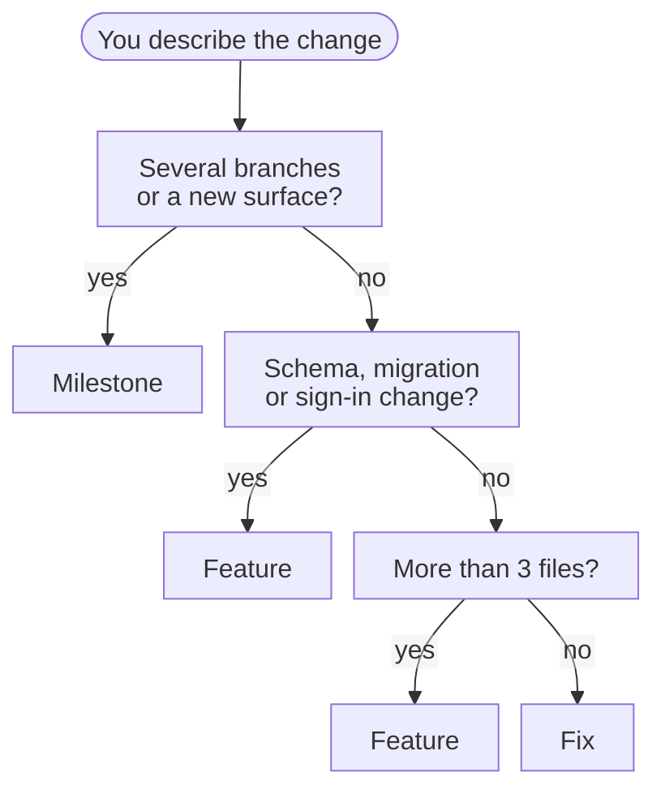
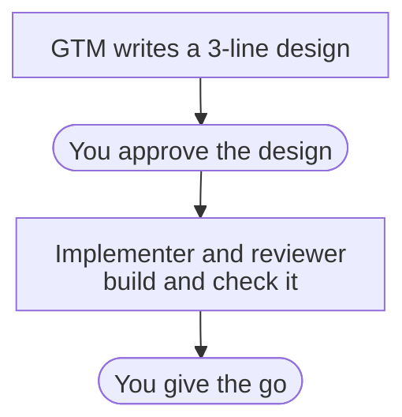
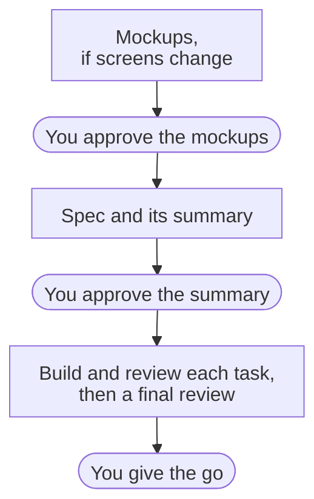
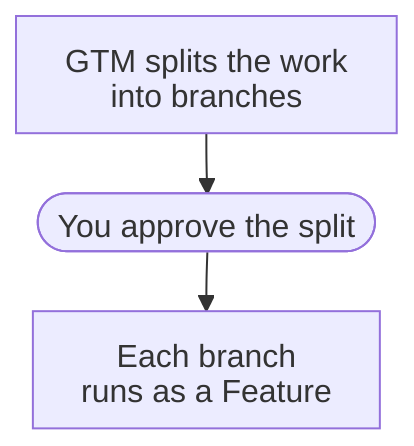
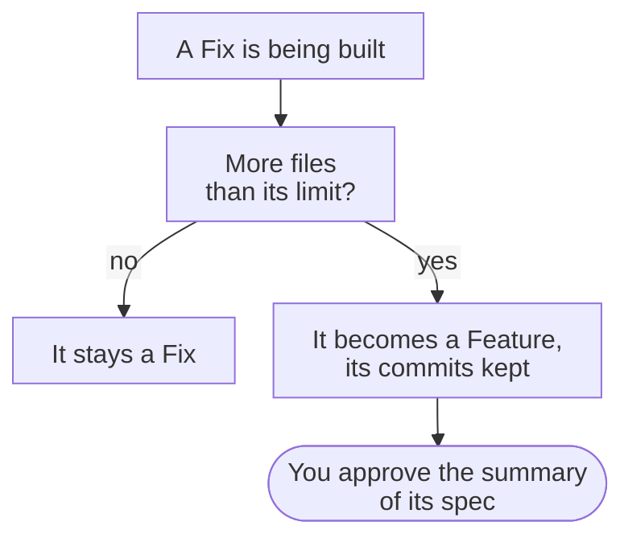

::: callout summary
- **You will learn:** how GTM sizes a change, and what each size asks of you.
- **Reading time:** 4 minutes.
- **Before this:** [Your first Feature](/tutorial/first-feature/) helps, but is not required.
:::

Three questions decide it. GTM sorts every change into one of three tracks: a
[Fix](/reference/glossary/#fix) (at most 3 files), a [Feature](/reference/glossary/#feature)
(one capability on one branch) or a [Milestone](/reference/glossary/#milestone) (several
branches). You describe the change; GTM asks at most two questions and proposes the track.

How to read it: start at the amber step, answer each question from the top, and stop at the
first track you reach.

## What does each track ask of me?

A few terms first:

- **[Checkpoint](/reference/glossary/#checkpoint):** a moment where you decide; the rest runs
  without you.
- **[Mockups](/reference/glossary/#mockups):** one page showing each new screen in light and dark.
- **[Spec](/reference/glossary/#spec):** the document that says what will be built and how each
  part is checked; you approve its ten-line [summary](/reference/glossary/#summary).
- **[Final review](/reference/glossary/#final-review):** one check of the whole branch against
  the spec, once every task is done, before you give the go.

### What does a Fix ask of me?

Two checkpoints. A Fix changes at most 3 files. It has no mockups, no spec and no final review.

How to read it: two amber steps, the design and the go. Everything else is the team's.

### What does a Feature ask of me?

Three checkpoints. A Feature is one capability on one branch.

How to read it: three amber steps; with no screen changes, the first one is skipped.

A small Feature changes no screen, schema, migration or sign-in, and touches at most twice the 3
files a Fix may change, so 6 files by default. The architect writes its spec and plan in one
pass. You still approve the summary and give the go; the plan is written again only if you answer
a decision otherwise or the spec changes.

### What does a Milestone ask of me?

One split, then Features. A Milestone spans several branches, or opens a new surface.

How to read it: you approve the split once, then each branch has a Feature's three checkpoints.

The same answer as a table, with the time per task measured on GTM's own branches from 17 to 23
November 2026 (GTM 0.23 to 0.28):

| Track | You decide | Time per task |
| --- | --- | --- |
| Fix | the 3-line design, then the go | about 5 min on the text path, 34 min on the full path |
| Feature | the mockups if screens change, the summary, the go | the same per task, times its tasks |
| Milestone | the split into branches, then each branch as a Feature | hours |

## Can the lead do it in session?

Yes, for a Fix or a small Feature, when you are there and want it fast or cheap. The lead, the
Claude you talk to, then does the work itself: no workflow and no reviewer agent. It keeps the
proof: each test written first and seen failing, one planted defect per new rule, each caught,
the project checks run before every commit, and the documentation pages it touched measured.
You still give the go before anything is pushed.

| Route | Time per task | Agent tokens per task | Measured on |
| --- | --- | --- | --- |
| The lead in session | 8 min | 0 | 14 tasks |
| Agents, text path | 5 min | 42k | 4 tasks |
| Agents, full path | 34 min | 217k | 9 tasks |

What you give up is a second pair of eyes. So code on a risky path, such as a script GTM ships,
ends with one review of the whole branch by a lighter model before the push. On GTM's own work,
two such reviews cost 31k and 36k tokens and found a crash and twelve issues, all fixed before
the merge. A product's data or security code, a Milestone and a branch past four hours keep the
full loop.

## What if a Fix grows?

Every Fix has a [file limit](/reference/glossary/#file-limit-for-a-fix), 3 files by default.

How to read it: a Fix that passes its limit continues from the spec, so you gain one amber
step. A change never goes back down a size.

::: callout note "Security and data code stay a Fix"
A Fix that touches security or data code stays a Fix. The security or data reviewer checks it,
as on any task.
:::
