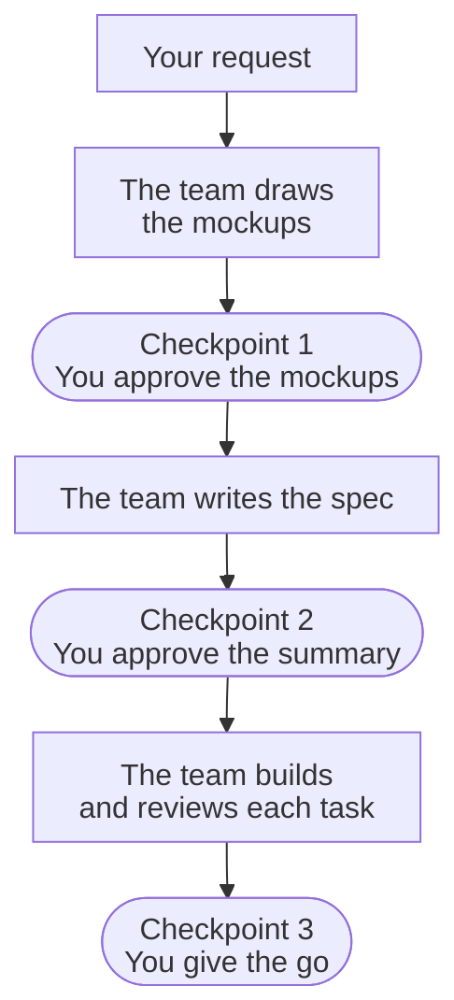

# A team of agents builds your change. You make three decisions.

::: callout summary
- **You will learn:** what GTM does, where you decide, and which page to read next.
- **Reading time:** 3 minutes.
- **Before this:** nothing.
:::

GentleTeaM (GTM) is a plugin for Claude Code. Its agents draw the
[mockups](/reference/glossary/#mockups) of your change (each new screen, light and dark), write
its [spec](/reference/glossary/#spec) (what will be built and how it is checked, opened by a
ten-line [summary](/reference/glossary/#summary) that you read), then build and review
it. You step in
at three [checkpoints](/reference/glossary/#checkpoint), the moments where you decide.

::: button "Start the tutorial" /tutorial/first-feature/ ::: ::: button "Install GTM" /start/install/ :::

## Where do I decide?



How to read it: amber nodes are yours, grey nodes are the team's. With no screen change, the
mockups step is skipped.

::: grids

::: grid

### Amber is you

On every page of this site, amber marks the moment where you act. Everything in grey is the
team's work, settled between the team's roles without you.

:::

::: grid

### Three checkpoints for a Feature

A [Feature](/reference/glossary/#feature) is one capability on one branch. You look at the
mockups, approve the ten-line summary of the spec, and give the go. A
[Fix](/reference/glossary/#fix), the small change, has two: you approve a three-line design,
then give the go.

:::

::: grid

### Nothing leaves without your go

No push, merge or release happens until you say so, and the history is kept as it was written.
You are shown every decision the team made for you, with its cost if wrong.

:::

:::

## Choose your way in

::: grids
::: grid
::: card "[Start here](/start/install/)"
What GTM is, and how to install it in two commands.
:::
:::
::: grid
::: card "[Tutorial](/tutorial/first-feature/)"
Your first Feature, from the request to the merge.
:::
:::
::: grid
::: card "[Guides](/guides/which-size/)"
One question per page, such as which size your change is.
:::
:::
::: grid
::: card "[Reference](/reference/roles/)"
The roles, the files GTM keeps, and every term.
:::
:::
::: grid
::: card "[Why](/why/)"
The problem GTM answers, and what it costs you.
:::
:::
:::

## Install

::: callout term "In a Claude Code session"
```text
/plugin marketplace add MorganKryze/GentleTeaM
/plugin install gtm@gentleteam
```
:::

Then, in your project, run `/gtm:init`. GTM reads your repository and drafts a one-page
[brief](/reference/glossary/#brief) of your project's purpose, users and limits, and you
approve it.

## What does it cost?

GTM spends agent time to save your attention. Measured on GTM's own changes:

| Change | Size | Agent time | Measured on |
| --- | --- | --- | --- |
| 2 files, on security ground | Fix | 71 s | GTM 0.3.0 |
| a docs fix and one workflow argument, 2 tasks | Feature | 11 min | GTM 0.3.0 |
| a workflow change, 3 tasks | Feature | 58 min | GTM 0.2.0 |

Installed and idle, GTM adds about 1,300 tokens to a session. A Feature uses more of your plan
than asking Claude Code directly; a Fix is the cheap path.
