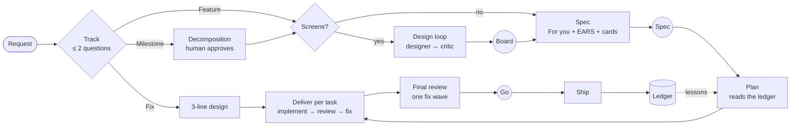

# The GTM method

> The reference description of GentleTeaM for a team adopting it. Work enters through one of three
> tracks; a Feature goes through design, spec, plan and delivery, with the human approving the
> board, the spec synthesis and the final go. Role agents hand work to each other through files,
> specialists join only when a change touches their ground, and every branch leaves lessons in a
> ledger that the next plan reads. Each project records its own weights in a team profile.

## The loop

Circles are the human touchpoints. Everything between them is settled inside the team.

## Tracks
| Track | When | Flow | Artifacts |
| --- | --- | --- | --- |
| Fix | at most the Fix ceiling (3 files by default), no schema, migration or auth change | 3-line design in chat, implementer and reviewer, plus the specialist on security or data ground | a brief in `reports/`, a ledger line if there is a lesson |
| Feature | one capability, one branch | design loop if screens change, spec, plan, deliver per task, final review | board, spec, plan, reports, ledger lines |
| Milestone | several branches, a new surface | a one-page decomposition, then the Feature flow per sub-feature, final review per branch | the Feature artifacts per branch |

The track is chosen up front with at most two questions. A Fix on security or data ground stays a
Fix: the specialist for that ground reviews it, as on any task. Nothing downgrades mid-task.

The Fix ceiling is the most files a Fix may change, 3 by default. It lives in the team profile
(`team.md`) as the Gates line `Fix track ceiling: N files`; `/gtm:init` sets it and `/gtm:tune`
changes it. Every file a Fix changes counts, a CHANGELOG included, and so do the files its fix
rounds add: a Fix of exactly the ceiling stays a Fix, one more file escalates. A change expected
to be larger is a Feature from the track pick. A Fix that passes the ceiling during delivery
escalates on its own, before review or right after the fix round that grew it, and continues as
a Feature from the spec. Its commits stay, its minor findings go to the ledger, and the findings
its last fix round answered, which no reviewer re-checked, become spec requirements with their
tests, so the final review checks them.

A small Feature has no screen, schema, migration or auth change and at most twice the Fix ceiling
in estimated files (6 by default). The architect writes its spec and plan in one pass, the plan
following each card's recommendation; the human approves the spec as for any Feature, and the plan
is written again only when a card is answered otherwise or the spec changes.

## Artifacts
All live under the GTM root, `.gtm/` by default (a project may move it and say so in its
CLAUDE.md, and may keep it out of git).

| File | What | Written by | Read by |
| --- | --- | --- | --- |
| `brief.md` | one-page constitution: purpose, users, principles, non-negotiables, non-goals, stack | init, amended rarely | every role |
| `config.yml` | mechanics: paths, verify commands, git rules, languages, briefing style | init | every skill and role |
| `team.md` | the team profile: priorities, model and effort per role, specialists, gates | init, `/gtm:tune` | every skill and workflow |
| `conventions.md` + `guidelines/*.md` | the project's conventions, one file per area, each with a "when to read" line | init, `/gtm:retro`, `/gtm:tune` | each role reads only its own files |
| `backlog.md` | epics, stories, priority, status | `/gtm:gtm`, `/gtm:ship` | analyst, human |
| `specs/` | one spec per Feature: For you, what and why, EARS acceptance, decisions | architect | human (For you), team |
| `plans/` | one plan per Feature: tasks with files, interfaces, TDD steps, verify command | architect | implementers, reviewers |
| `mockups/` | design boards (HTML and PNG) | designer | critic, human, ux-qa |
| `reports/` | task briefs, agent reports, progress, final review, PR text | every role | the team; the human on demand |
| `ledger.md` | append-only one-line lessons, rulings, deferred minors, run summaries | every skill | architect at plan time, `/gtm:tune` |

## Roles
Eleven role agents, each with one job, a method, a severity scale where relevant and a hand-back
contract. See [roles](roles.md).

| Always on a Feature | On trigger | Once per branch | Around the work |
| --- | --- | --- | --- |
| architect, implementer, reviewer | security-reviewer, data-reviewer, ux-qa (by changed paths); designer and design-critic (when screens change) | final-reviewer | analyst (track, init), release-qa (after deployment) |

## Gates
| Gate | Passes when | Otherwise |
| --- | --- | --- |
| Board | critic score at or above the threshold (8/10 by default) with zero must-fix, within the round cap | the human chooses: approve as is, one more round, change the brief |
| Spec | zero `[NEEDS CLARIFICATION]`, every decision card answered, human approval | back to the architect, or a card to the human |
| Plan | every task has files, TDD steps and a verify command; every EARS line maps to a test; risky tasks replayed | one correction round with the architect |
| Task | every triggered reviewer approves (no critical or important finding) within the fix-round cap | the human chooses: revise the plan, accept with findings logged, take over |
| Branch | the final review says ready, after at most one fix wave | a decision card to the human |
| Ship | the human's explicit go for that exact action | nothing leaves the machine |

## Hand-offs and hand-backs
- **Hand-off:** an agent receives paths (brief, spec, plan, report file), never pasted documents.
- **Hand-back:** at most ten lines, or the structured object a workflow asks for: status, files,
  verify result, concerns. The full report goes to the report file when one is given, else into
  that object's summary; an agent never creates one, and the structured call is its last action.
  A critic or reviewer is retried once when it throws, on a 25-call budget, before the
  workflow's fallback; a blocked or skipped one is not re-dispatched, nor is an implementer.
- **Fresh context:** reviewers see the brief, the report and the diff, never the implementer's
  reasoning. Re-reviews in a fix round go only to the reviewers who flagged something and every
  specialist whose ground the fix diff touches, and check only their findings and the fix diff.
- **Fix rounds:** at most three per task by default; each round raises the implementer's effort one
  level.

## Team profile
`team.md` records how this project weighs its work, so nobody restates it.
- **Priorities** (security, data integrity, UX and accessibility, performance, delivery speed,
  usage and cost sensitivity), each low, normal or high, with a reason and a date.
- **Roles:** model and effort per role, each with a reason. Agents keep defaults in their
  frontmatter; skills and workflows pass the profile's values on every dispatch, so the profile wins.
- **Specialists:** which exist, their path triggers.
- **Gates:** fix rounds, Fix ceiling, design threshold and rounds, whether risky tasks are replayed
  and which paths are risky.

`/gtm:init` derives a proposal from the brief (a multi-account server raises security; stored
personal records raise data integrity; tight usage limits lower the effort of high-volume roles
first) and the human approves or edits it. `/gtm:tune` re-evaluates it from the ledger's evidence
and records each change with its date.

## Conventions
`conventions.md` summarises the project's conventions in one table; each row points at a small
guideline file under `guidelines/`: code, tests, git (commits, branches, PRs, merges, releases),
docs, dependencies, security, data, language and copy, accessibility, design, and work (priority,
epics and stories, definition of done). `/gtm:init` proposes defaults adapted to what the repository
already does; the human accepts or edits them in one pass. Agents read only the files their role
needs. `/gtm:retro` proposes guideline edits for recurring lessons; `/gtm:tune` revisits a
convention that keeps producing the same finding.

## Backlog: epics, stories, priority
- **Epic:** a Milestone or a group of Features.
- **Story:** one user-visible outcome with acceptance lines; a bug is a story of type bug. A story is
  delivered by one track. Its acceptance lines become the spec's EARS lines; plan tasks are how it
  is built, not stories.
- **Priority:** P0 (broken, data at risk, security hole: now), P1 (blocks the next release), P2
  (planned), P3 (nice to have).
- **Done:** per track, as `guidelines/work.md` defines it: verified, reviewed, documented, ledger
  updated, and the human's go.

`backlog.md` stays a single table per epic. `/gtm:gtm` adds or updates the story when work starts;
`/gtm:ship` marks it done.

## Ledger and the compound step
`ledger.md` is append-only, one line per entry: `- <date> · <slug> · <kind> · <text>`, with kinds
`lesson`, `ruling`, `minor`, `resolved`, `run` and `usage`. Superseded lines are struck through,
never deleted. The architect reads it before every plan and lists the lessons it applied;
`/gtm:retro` distils each delivered branch into at most five lessons and promotes recurring ones to
guidelines; `/gtm:tune` reads the `run` and `usage` lines to adjust the team profile. This is how
each branch makes the next one cheaper.

## Stealth mode
Stealth mode is for work in a repository whose history is not yours to sign: a client's project,
an open-source project you contribute to. GTM still runs the same team; it just leaves no trace in
the project, and what it writes there reads like the project's own people wrote it.

**What it changes**
| Area | Stealth off (default) | Stealth on |
| --- | --- | --- |
| GTM's files | `.gtm/` may be committed, reports and mockups excluded | the whole root excluded through `.git/info/exclude`, or kept outside the repository |
| Tracked files | a `GTM root:` line in CLAUDE.md when the root moves | nothing: no README badge, no CLAUDE.md or AGENTS.md line, no committed `.claude/settings.json`; GTM is installed at user scope |
| Commits, PRs, docs, comments, changelogs, branch names | plain writing | no GTM name (GTM, `.gtm`, roles, skills, plans, ledger, workflows), no attribution trailer, branches in the project's pattern |
| Voice | `guidelines/voice.md` is read | `guidelines/voice.md` is mandatory |
| Ship | gate check | gate check, then the footprint check; a hit stops the ship |

The project voice guideline is part of every project's conventions. It asks for the voice found in
the project's own `git log`, docs and comments, and for plain writing: no filler or hedging, no
stock phrases, no reflexive lists of three, no em-dash habit, no emoji clutter, no bullet walls for
short content, specific words, active voice, varied sentence length.

**How to switch it.** `/gtm:init` asks, with a recommendation from what it found (who owns the
repository, its contributors, any policy on tools). `/gtm:tune stealth on` or `off` switches it
later. Turning it on offers to remove what GTM already left in tracked files, in one commit; pushed
history is never rewritten.

**What the footprint check scans.** `plugins/gtm/scripts/footprint-check.mjs`, a Node script with
no dependencies, reads the branch against its base: the branch name, every commit message, the PR
text, every line the diff adds and every new file name. It reports each hit with its location:
GTM's vocabulary, the names of excluded paths (the root, the mockups folder, `git.never_name`,
`.git/info/exclude`), the attribution text in `git.forbid`, and in prose (commit messages, the PR,
doc files, comment lines) em dashes, emoji, stock phrases, filler and hedging. Lists of three and
runs of short bullets come back as notes, since a pattern cannot tell them from honest lists. The
`footprint` block of `config.yml` adds words, allows known false positives and skips tells the
project's own voice uses. Sentence length and passive voice are left to the voice guideline.

Stealth mode changes what GTM writes into your project; it does not change any rules your organisation or the projects you contribute to set about tools and disclosure — follow those.

## Skills
| Skill | Does |
| --- | --- |
| `/gtm:gtm` | the entry point (bare `/gtm` when unambiguous): explains the method, picks the track, routes |
| `/gtm:init` | drafts and confirms brief, config, team profile, conventions |
| `/gtm:design` | runs the design loop, presents the scored board |
| `/gtm:spec` | writes the spec, presents the For-you block and decision cards |
| `/gtm:plan` | writes the task plan, replays risky tasks |
| `/gtm:deliver` | delivers the plan task by task, final review, rulings |
| `/gtm:ship` | PR text, the footprint check in stealth mode; push, merge, tag or release on the human's go |
| `/gtm:retro` | distils lessons into the ledger and guidelines |
| `/gtm:tune` | re-evaluates the team profile and conventions from evidence; switches stealth mode |
| `/gtm:brief-me` | re-presents any artifact at brief, standard or deep detail |

Workflows: `gtm:design-loop` and `gtm:deliver-task`, run by the skills above.
