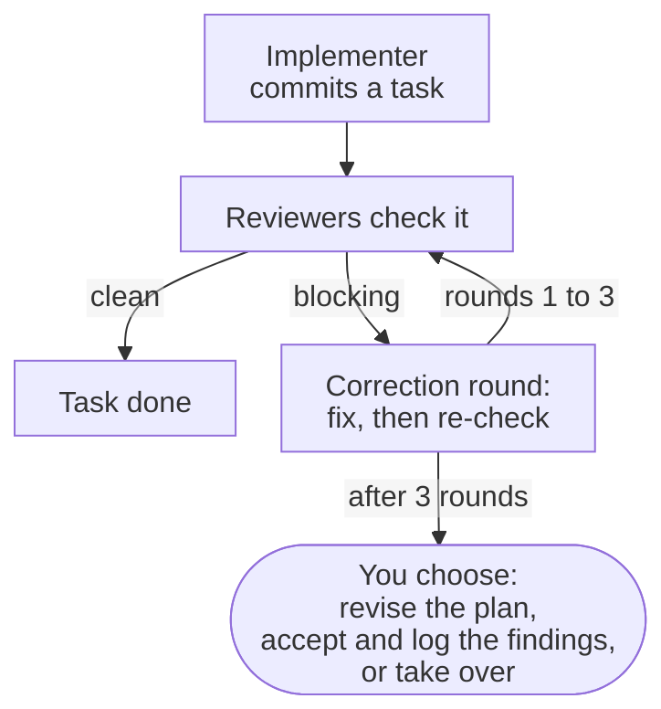

::: callout summary
- **You will learn:** what each of the eleven roles does, how hard it thinks, and when it runs.
- **Reading time:** 5 minutes, or look up one row.
- **Before this:** [Which size is my change?](/guides/which-size/) for the tracks.
:::

GTM ships eleven role agents. Each has one job, reads only the guidelines its role needs, and
writes its full report to a file you never have to open. Reviewers are read-only. Every role
runs Opus, Claude's largest model, and roles differ by effort (defined below); your
[team settings](/reference/glossary/#team-settings) can change any of them.

## Who does what, and when?

The words in the table and below it:

- **[Spec](/reference/glossary/#spec):** the document the architect writes before any code: what
  will be built, what is left out, and how each part is checked.
- **[Mockups](/reference/glossary/#mockups):** one page showing each new screen in light and dark.
- **[Correction round](/reference/glossary/#correction-round):** the implementer fixes the open
  findings, then the same reviewers re-check; three at most.
- **[Final review](/reference/glossary/#final-review):** one last check of the whole branch
  against the spec and the plan, once every task is done.
- **Effort:** how hard a role reasons, from low to xhigh. More effort finds more, and costs more
  of your plan.
- **[Dry run](/reference/glossary/#dry-run):** the architect runs a risky task's code in a
  scratch copy while planning, to prove the plan.
- **[Logbook](/reference/glossary/#logbook):** `.gtm/ledger.md`, one line per lesson, ruling or
  deferred finding.

| Role | Job | Effort | When it runs |
| --- | --- | --- | --- |
| `analyst` | sizes the request, drafts the setup | medium | sizing, `/gtm:init` |
| `designer` | draws the mockups | medium | mockup rounds |
| `design-critic` | scores the mockups by measuring; read-only | high | mockup rounds |
| `architect` | writes the spec and the task plan | high | after the mockups |
| `implementer` | one task, test-first; the only role that writes code | low, raised per round | every task |
| `reviewer` | checks the spec, then code quality; read-only | medium | every task |
| `security-reviewer` | trust boundaries, sign-in, secrets; read-only | xhigh | the diff touches its paths |
| `data-reviewer` | lost, duplicated or altered data; read-only | high | the diff touches its paths |
| `ux-qa` | captures and measures screens | medium | the diff touches screens |
| `final-reviewer` | the whole branch against the spec; read-only | xhigh | once per branch |
| `release-qa` | the live journey after you deploy | low | after deployment |

## What happens when a reviewer finds something?

How to read it: you appear only when three correction rounds were not enough.

## How severe is a finding?

| Severity | Meaning | Effect |
| --- | --- | --- |
| `critical` | wrong data, a crash, a security hole | blocks the task, starts a correction round |
| `important` | a spec gap, a bug a person hits, an accessibility failure | blocks the task, starts a correction round |
| `minor` | polish, coverage, style | written to the logbook, sorted at the final review |

Every task review adds a scope rule, read against the task's whole range on every round: a
defect the task's change did not introduce (it neither adds nor changes the faulty lines nor
makes them newly reachable) is `minor`, its summary saying it predates the task, unless it is
critical, a security hole or a data-integrity defect. On a re-check, each finding sent keeps its
severity until it is addressed; a finding returned as `addressed` no longer blocks and is not
counted, and one returned without a status stays open.

## What does a role send back?

Each role ends with a short hand-back: at most ten lines (twelve for the architect, fifteen for
`release-qa`), or the structured object a workflow asks for. It gives the status, the files, the
result of the checks, any concerns and the path of the full report. A role never claims a result
without the command that proved it.

## Which rules does every role follow?

- **Reads first:** `.gtm/config.yml` and `.gtm/brief.md`, and never hard-codes a rule the
  config can state.
- **Never publishes:** a role never pushes, merges, tags or switches branches.
- **Never delegates:** a role never dispatches other agents; the commands do.
- **Read-only stays read-only:** a reviewer that needs to run something uses a scratch copy of
  the repository.

## What does Claude Code ignore in a role?

Claude Code ignores `hooks`, `mcpServers` and `permissionMode` in a plugin agent's frontmatter.
GTM's roles rely on none of them: their permissions come from your session.

To change a role's model or effort, see [Change your team settings](/guides/team-settings/).
